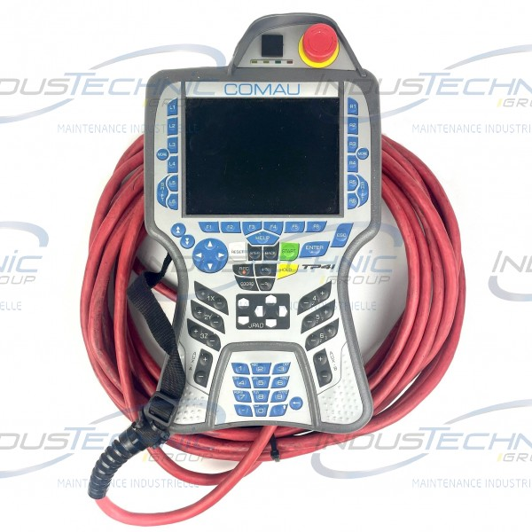

# Comau NS16 Pendant

This section captures documentation specific to the Comau NS16 touch pendant,
including mechanical details, connector tracing, display and touch hardware,
keypad mapping, and any reverse-engineered interface behavior.

## Scope

- Pendant enclosure and internal layout
- Pendant cable exits and internal connectors
- Keypad matrix and key labeling
- Display and touch subsystem
- Safety-related controls on the pendant
- Reverse-engineered signal mapping

## Current Known Facts

- There are six internal keypad-related connectors emerging from the pendant.
- Each connector is a `1x9`, `2.54 mm` pitch header attached to flexible
  ribbon.
- The connectors do not provide wire colours for identification.
- Each connector presents a `4 row x 5 column` matrix.
- The keypad-to-connector relationship still needs to be traced and documented.

## Working Documents

- `keypad-connector-mapping.md`: trace sheet for the six internal 9-way
  connectors and keypad signals.

## Reference Photo

This is the current external reference photo kept as-is, including the source
watermark, until pendant-specific photos are captured.

## Pendant Inventory

| Item | Value | Source | Notes |
| --- | --- | --- | --- |
| Pendant model | pending | pending | |
| Connector count | 6 | direct observation | Six 9-way connectors emerging from the pendant |
| Connector type | 1x9, 2.54 mm pitch header | direct observation | Flexible ribbon termination |
| Display assembly | pending | pending | |
| Touch subsystem | pending | pending | |
| Keypad assembly | pending | pending | |
| E-stop / enable hardware | pending | pending | |

## Connector Summary

| Connector | Way count | Physical location | Probable function | Status | Notes |
| --- | --- | --- | --- | --- | --- |
| C1 | 9 | pending | 4x5 matrix | open | Row/column identity still to be assigned |
| C2 | 9 | pending | 4x5 matrix | open | Row/column identity still to be assigned |
| C3 | 9 | pending | 4x5 matrix | open | Row/column identity still to be assigned |
| C4 | 9 | pending | 4x5 matrix | open | Row/column identity still to be assigned |
| C5 | 9 | pending | 4x5 matrix | open | Row/column identity still to be assigned |
| C6 | 9 | pending | 4x5 matrix | open | Row/column identity still to be assigned |

## Reverse-Engineering Tasks

- Identify and name the six 9-way connectors consistently.
- Record pin numbering orientation for each connector before tracing signals.
- Assign the four row lines and five column lines for each connector.
- Fill in the key present at each row/column crossing.
- Link every conclusion back to photos, continuity tests, or captures.

## Open Questions

- Are all six 9-way connectors unique, or are some duplicated harness breakouts?
- What is the pin numbering orientation for each ribbon header?
- Do all six connectors represent independent keypad matrices, or are some
  partially populated?
- Which physical key belongs at each row/column crossing?

## Change Log

| Date | Author | Change |
| --- | --- | --- |
| 2026-03-24 | Codex | Added pendant documentation index and connector-tracing scaffold. |
